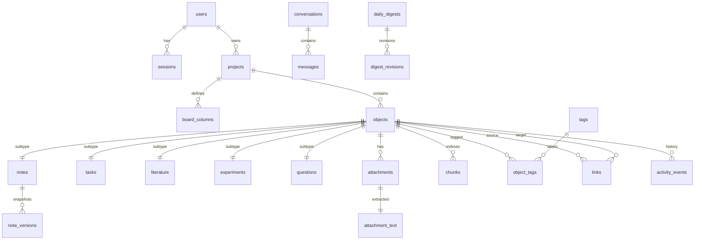

# 04 — Data model and storage schema

**Engine:** SQLite ≥ 3.45, WAL mode. All timestamps are ISO-8601 UTC strings (`2026-11-16T10:14:00.000Z`). Dates without time (`due_date`, digest `date`) are `YYYY-MM-DD` in the user's timezone and are documented as such.

Conventions:

- Text primary keys are type-prefixed ULIDs (`note_01JB…`).
- Booleans are `INTEGER` 0/1.
- Free-form structured data is `TEXT` JSON (validated in code).
- `created_at`/`updated_at` exist on every mutable aggregate.
- Soft delete uses `deleted_at`; activity events are never deleted.
- Foreign keys are ON; deletes cascade only for owned child rows (blocks/versions/links), never for activity.

---

## 1. ER diagram (core)



## 2. Tables

### Identity

> Users are never hard-deleted in v1. `objects.created_by` references them, and activity history must stay attributable.

```sql
CREATE TABLE users (
  id TEXT PRIMARY KEY,
  username TEXT NOT NULL UNIQUE COLLATE NOCASE,
  display_name TEXT NOT NULL DEFAULT '',
  password_hash TEXT NOT NULL,
  is_admin INTEGER NOT NULL DEFAULT 1,
  timezone TEXT NOT NULL DEFAULT 'UTC',
  created_at TEXT NOT NULL,
  updated_at TEXT NOT NULL
);

CREATE TABLE sessions (  id TEXT PRIMARY KEY,
  user_id TEXT NOT NULL REFERENCES users(id) ON DELETE CASCADE,
  token_hash TEXT NOT NULL UNIQUE,        -- sha256 of the cookie secret
  csrf_token TEXT NOT NULL,
  created_at TEXT NOT NULL,
  expires_at TEXT NOT NULL,
  last_seen_at TEXT NOT NULL,
  user_agent TEXT,
  ip TEXT
);
CREATE INDEX idx_sessions_user ON sessions(user_id);
CREATE INDEX idx_sessions_expiry ON sessions(expires_at);
```

### Projects and board

```sql
CREATE TABLE projects (
  id TEXT PRIMARY KEY,
  name TEXT NOT NULL,
  description TEXT NOT NULL DEFAULT '',
  color TEXT NOT NULL DEFAULT 'lavender',
  status TEXT NOT NULL DEFAULT 'active' CHECK (status IN ('active','archived')),
  settings_json TEXT NOT NULL DEFAULT '{}',
  created_at TEXT NOT NULL,
  updated_at TEXT NOT NULL,
  deleted_at TEXT
);

CREATE TABLE board_columns (
  id TEXT PRIMARY KEY,
  project_id TEXT NOT NULL REFERENCES projects(id) ON DELETE CASCADE,
  name TEXT NOT NULL,
  is_done INTEGER NOT NULL DEFAULT 0,
  position INTEGER NOT NULL DEFAULT 0,
  created_at TEXT NOT NULL,
  updated_at TEXT NOT NULL
);
CREATE INDEX idx_columns_project ON board_columns(project_id, position);
```

### Universal object

```sql
CREATE TABLE objects (
  id TEXT PRIMARY KEY,
  type TEXT NOT NULL,                     -- note|task|reference|experiment|question
  title TEXT NOT NULL DEFAULT '',
  subtitle TEXT NOT NULL DEFAULT '',
  project_id TEXT REFERENCES projects(id),
  status TEXT,
  version INTEGER NOT NULL DEFAULT 1,
  favorite INTEGER NOT NULL DEFAULT 0,
  metadata_json TEXT NOT NULL DEFAULT '{}',
  created_at TEXT NOT NULL,
  updated_at TEXT NOT NULL,
  created_by TEXT NOT NULL REFERENCES users(id),
  updated_by TEXT NOT NULL REFERENCES users(id),
  deleted_at TEXT
);
CREATE INDEX idx_objects_type ON objects(type, deleted_at);
CREATE INDEX idx_objects_project ON objects(project_id, type, deleted_at);
CREATE INDEX idx_objects_updated ON objects(updated_at DESC);
CREATE INDEX idx_objects_status ON objects(type, status);
```

### Subtables

```sql
CREATE TABLE notes (
  id TEXT PRIMARY KEY REFERENCES objects(id) ON DELETE CASCADE,
  blocks_json TEXT NOT NULL DEFAULT '[]',
  plain_text TEXT NOT NULL DEFAULT '',
  template TEXT NOT NULL DEFAULT 'research',
  pinned INTEGER NOT NULL DEFAULT 0,
  word_count INTEGER NOT NULL DEFAULT 0
);

CREATE TABLE note_versions (
  id TEXT PRIMARY KEY,
  note_id TEXT NOT NULL REFERENCES notes(id) ON DELETE CASCADE,
  version INTEGER NOT NULL,
  title TEXT NOT NULL,
  blocks_json TEXT NOT NULL,
  reason TEXT NOT NULL DEFAULT 'autosave',
  created_at TEXT NOT NULL
);
CREATE INDEX idx_note_versions ON note_versions(note_id, version DESC);

CREATE TABLE tasks (
  id TEXT PRIMARY KEY REFERENCES objects(id) ON DELETE CASCADE,
  column_id TEXT NOT NULL REFERENCES board_columns(id),
  description TEXT NOT NULL DEFAULT '',
  priority TEXT NOT NULL DEFAULT 'normal' CHECK (priority IN ('low','normal','high','urgent')),
  due_date TEXT,
  start_date TEXT,
  completed_at TEXT,
  position INTEGER NOT NULL DEFAULT 0,
  checklist_json TEXT NOT NULL DEFAULT '[]',
  estimate_minutes INTEGER,
  metrics_json TEXT NOT NULL DEFAULT '[]'
);
CREATE INDEX idx_tasks_column ON tasks(column_id, position);
CREATE INDEX idx_tasks_due ON tasks(due_date) WHERE due_date IS NOT NULL;

CREATE TABLE literature (
  id TEXT PRIMARY KEY REFERENCES objects(id) ON DELETE CASCADE,
  cite_key TEXT NOT NULL UNIQUE,
  type TEXT NOT NULL DEFAULT 'article',
  authors_json TEXT NOT NULL DEFAULT '[]',
  year INTEGER,
  venue TEXT NOT NULL DEFAULT '',
  doi TEXT,
  url TEXT,
  abstract TEXT NOT NULL DEFAULT '',
  published_at TEXT,
  reading_status TEXT NOT NULL DEFAULT 'unread'
    CHECK (reading_status IN ('unread','reading','reviewed','archived')),
  rating INTEGER,
  notes TEXT NOT NULL DEFAULT '',
  extra_json TEXT NOT NULL DEFAULT '{}',
  ai_summary TEXT NOT NULL DEFAULT '',
  ai_summary_model TEXT,
  ai_summary_at TEXT,
  ai_summary_instructions TEXT NOT NULL DEFAULT '',
  added_at TEXT NOT NULL
);
CREATE INDEX idx_lit_doi ON literature(doi);
CREATE INDEX idx_lit_status ON literature(reading_status);
CREATE INDEX idx_lit_year ON literature(year);

CREATE TABLE reference_bookmarks (
  id TEXT PRIMARY KEY,
  reference_id TEXT NOT NULL REFERENCES literature(id) ON DELETE CASCADE,
  page INTEGER NOT NULL CHECK (page > 0),
  note TEXT NOT NULL DEFAULT '' CHECK (length(note) <= 250),
  created_at TEXT NOT NULL,
  updated_at TEXT NOT NULL
);
CREATE INDEX idx_reference_bookmarks_ref ON reference_bookmarks(reference_id, page);

CREATE TABLE experiments (
  id TEXT PRIMARY KEY REFERENCES objects(id) ON DELETE CASCADE,
  objective TEXT NOT NULL DEFAULT '',
  hypothesis TEXT NOT NULL DEFAULT '',
  method TEXT NOT NULL DEFAULT '',
  environment_json TEXT NOT NULL DEFAULT '{}',
  results TEXT NOT NULL DEFAULT '',
  metrics_json TEXT NOT NULL DEFAULT '[]',
  status TEXT NOT NULL DEFAULT 'planned'
    CHECK (status IN ('planned','running','completed','abandoned')),
  started_at TEXT,
  ended_at TEXT
);

CREATE TABLE questions (
  id TEXT PRIMARY KEY REFERENCES objects(id) ON DELETE CASCADE,
  context TEXT NOT NULL DEFAULT '',
  status TEXT NOT NULL DEFAULT 'open'
    CHECK (status IN ('open','investigating','answered','parked')),
  answer_note_id TEXT REFERENCES notes(id) ON DELETE SET NULL,
  answered_at TEXT
);
```

### Capture, tags, links

```sql
CREATE TABLE inbox_items (
  id TEXT PRIMARY KEY,
  body TEXT NOT NULL,
  kind TEXT NOT NULL DEFAULT 'idea',
  status TEXT NOT NULL DEFAULT 'new' CHECK (status IN ('new','triaged','archived')),
  project_id TEXT REFERENCES projects(id),
  triaged_object_id TEXT,
  created_at TEXT NOT NULL,
  updated_at TEXT NOT NULL,
  triaged_at TEXT
);
CREATE INDEX idx_inbox_status ON inbox_items(status, created_at DESC);

CREATE TABLE tags (
  id TEXT PRIMARY KEY,
  name TEXT NOT NULL UNIQUE COLLATE NOCASE,
  color TEXT NOT NULL DEFAULT 'lavender',
  created_at TEXT NOT NULL
);

CREATE TABLE object_tags (
  object_id TEXT NOT NULL REFERENCES objects(id) ON DELETE CASCADE,
  tag_id TEXT NOT NULL REFERENCES tags(id) ON DELETE CASCADE,
  PRIMARY KEY (object_id, tag_id)
);
CREATE INDEX idx_object_tags_tag ON object_tags(tag_id);

CREATE TABLE links (
  id TEXT PRIMARY KEY,
  source_id TEXT NOT NULL REFERENCES objects(id) ON DELETE CASCADE,
  target_id TEXT NOT NULL REFERENCES objects(id) ON DELETE CASCADE,
  kind TEXT NOT NULL DEFAULT 'relates',
  anchor TEXT,
  created_at TEXT NOT NULL,
  deleted_at TEXT
);
CREATE UNIQUE INDEX idx_links_unique ON links(source_id, target_id, kind)
  WHERE deleted_at IS NULL;
CREATE INDEX idx_links_target ON links(target_id, kind) WHERE deleted_at IS NULL;
```

### Files

```sql
CREATE TABLE attachments (
  id TEXT PRIMARY KEY,
  object_id TEXT NOT NULL REFERENCES objects(id) ON DELETE CASCADE,
  kind TEXT NOT NULL,
  blob_hash TEXT NOT NULL,
  filename TEXT NOT NULL,
  mime TEXT NOT NULL,
  size INTEGER NOT NULL,
  page_count INTEGER,
  text_status TEXT NOT NULL DEFAULT 'none',   -- none|pending|ready|failed
  text_error TEXT,
  meta_json TEXT NOT NULL DEFAULT '{}',
  created_at TEXT NOT NULL,
  extracted_at TEXT
);
CREATE INDEX idx_attachments_object ON attachments(object_id);
CREATE INDEX idx_attachments_blob ON attachments(blob_hash);

CREATE TABLE attachment_text (
  attachment_id TEXT PRIMARY KEY REFERENCES attachments(id) ON DELETE CASCADE,
  text TEXT NOT NULL,
  page_map_json TEXT NOT NULL DEFAULT '[]'
);
```

### Retrieval

```sql
CREATE TABLE chunks (
  id TEXT PRIMARY KEY,
  object_id TEXT NOT NULL REFERENCES objects(id) ON DELETE CASCADE,
  attachment_id TEXT REFERENCES attachments(id) ON DELETE CASCADE,
  locator_json TEXT NOT NULL DEFAULT '{}',
  text TEXT NOT NULL,
  token_count INTEGER NOT NULL DEFAULT 0,
  embedding BLOB,
  embedding_model TEXT,
  embedding_dim INTEGER,
  created_at TEXT NOT NULL
);
CREATE INDEX idx_chunks_object ON chunks(object_id);
CREATE INDEX idx_chunks_attachment ON chunks(attachment_id);
CREATE INDEX idx_chunks_model ON chunks(embedding_model);

CREATE VIRTUAL TABLE search_fts USING fts5(
  title,
  body,
  tags,
  object_id UNINDEXED,
  tokenize = 'unicode61 remove_diacritics 2'
);

-- Chunk-level text index: PDF and long-note content with locators.
CREATE VIRTUAL TABLE chunks_fts USING fts5(
  text,
  chunk_id UNINDEXED,
  object_id UNINDEXED,
  tokenize = 'unicode61 remove_diacritics 2'
);

-- BM25 weights (title, body, tags) = (8, 1, 3); snippet column index = 1 (body).
```

Both FTS tables are maintained by the search service (delete-by-object-id then insert). They are not trigger-driven because body composition is type-aware and lives in the object registry. Chunks are written synchronously with the object; embeddings are filled asynchronously. `chunks_fts` is rebuilt from `chunks` on a full-ish reindex, and is skipped during restore (rebuilt by a job).

### Activity and journal

```sql
CREATE TABLE activity_events (
  seq INTEGER PRIMARY KEY AUTOINCREMENT,
  id TEXT NOT NULL UNIQUE,
  actor_id TEXT NOT NULL,
  project_id TEXT,
  object_id TEXT,
  object_type TEXT,
  object_title TEXT,
  action TEXT NOT NULL,
  summary TEXT NOT NULL,
  changes_json TEXT,
  source TEXT NOT NULL DEFAULT 'ui',
  request_id TEXT,
  occurred_at TEXT NOT NULL
);
CREATE INDEX idx_events_time ON activity_events(occurred_at DESC);
CREATE INDEX idx_events_project_time ON activity_events(project_id, occurred_at DESC);
CREATE INDEX idx_events_object ON activity_events(object_id, occurred_at DESC);

CREATE TABLE daily_digests (
  id TEXT PRIMARY KEY,
  user_id TEXT NOT NULL REFERENCES users(id) ON DELETE CASCADE,
  date TEXT NOT NULL,
  timezone TEXT NOT NULL,
  diff_json TEXT NOT NULL,
  summary_md TEXT,
  model TEXT,
  status TEXT NOT NULL DEFAULT 'ready' CHECK (status IN ('pending','ready','failed')),
  generated_at TEXT,
  regenerated_count INTEGER NOT NULL DEFAULT 0,
  source_event_seq INTEGER,             -- max(activity_events.seq) at generation
  UNIQUE (user_id, date)
);

CREATE TABLE digest_revisions (
  id TEXT PRIMARY KEY,
  digest_id TEXT NOT NULL REFERENCES daily_digests(id) ON DELETE CASCADE,
  summary_md TEXT NOT NULL,
  diff_json TEXT NOT NULL,
  model TEXT,
  created_at TEXT NOT NULL
);
```

### AI

```sql
CREATE TABLE ai_providers (
  id TEXT PRIMARY KEY,
  name TEXT NOT NULL,
  kind TEXT NOT NULL DEFAULT 'openai',   -- openai | fake
  base_url TEXT NOT NULL DEFAULT 'https://api.openai.com/v1',
  api_key_enc TEXT,
  chat_model TEXT NOT NULL DEFAULT '',
  embed_model TEXT NOT NULL DEFAULT '',
  rerank_model TEXT NOT NULL DEFAULT '',
  is_default INTEGER NOT NULL DEFAULT 0,
  extra_json TEXT NOT NULL DEFAULT '{}',
  created_at TEXT NOT NULL,
  updated_at TEXT NOT NULL
);

CREATE TABLE conversations (
  id TEXT PRIMARY KEY,
  user_id TEXT NOT NULL REFERENCES users(id) ON DELETE CASCADE,
  title TEXT NOT NULL DEFAULT 'New conversation',
  scope TEXT NOT NULL DEFAULT 'project'
    CHECK (scope IN ('global','project','selection')),
  project_id TEXT REFERENCES projects(id) ON DELETE SET NULL,
  context_json TEXT NOT NULL DEFAULT '[]',
  provider_id TEXT,
  model TEXT,
  created_at TEXT NOT NULL,
  updated_at TEXT NOT NULL,
  deleted_at TEXT
);

CREATE TABLE messages (
  id TEXT PRIMARY KEY,
  conversation_id TEXT NOT NULL REFERENCES conversations(id) ON DELETE CASCADE,
  role TEXT NOT NULL CHECK (role IN ('user','assistant','system')),
  content TEXT NOT NULL,
  citations_json TEXT NOT NULL DEFAULT '[]',
  usage_json TEXT NOT NULL DEFAULT '{}',
  provider TEXT,
  model TEXT,
  error TEXT,
  created_at TEXT NOT NULL
);
CREATE INDEX idx_messages_conversation ON messages(conversation_id, created_at);
```

Conversations are intentionally not `objects` (see `03-domain-model.md §2`).

### Jobs, settings, backups

```sql
CREATE TABLE jobs (
  id TEXT PRIMARY KEY,
  type TEXT NOT NULL,
  payload_json TEXT NOT NULL DEFAULT '{}',
  status TEXT NOT NULL DEFAULT 'queued'
    CHECK (status IN ('queued','running','succeeded','failed','dead')),
  priority INTEGER NOT NULL DEFAULT 100,
  attempts INTEGER NOT NULL DEFAULT 0,
  max_attempts INTEGER NOT NULL DEFAULT 3,
  run_at TEXT NOT NULL,
  started_at TEXT,
  finished_at TEXT,
  last_error TEXT,
  idempotency_key TEXT UNIQUE,
  dismissed_at TEXT,
  created_at TEXT NOT NULL
);
CREATE INDEX idx_jobs_pick ON jobs(status, run_at, priority);
CREATE INDEX idx_jobs_type ON jobs(type, status);

CREATE TABLE settings (
  key TEXT PRIMARY KEY,
  value_json TEXT NOT NULL,
  updated_at TEXT NOT NULL
);

CREATE TABLE user_settings (
  user_id TEXT NOT NULL REFERENCES users(id) ON DELETE CASCADE,
  key TEXT NOT NULL,
  value_json TEXT NOT NULL,
  updated_at TEXT NOT NULL,
  PRIMARY KEY (user_id, key)
);

CREATE TABLE backups (
  id TEXT PRIMARY KEY,
  filename TEXT NOT NULL,
  kind TEXT NOT NULL DEFAULT 'manual',   -- manual|auto|pre_migration|pre_restore
  size INTEGER NOT NULL DEFAULT 0,
  checksum TEXT NOT NULL DEFAULT '',
  status TEXT NOT NULL DEFAULT 'ready' CHECK (status IN ('ready','failed','missing')),
  created_at TEXT NOT NULL
);
```

### Schema migrations

```sql
CREATE TABLE schema_migrations (
  version INTEGER PRIMARY KEY,
  name TEXT NOT NULL,
  checksum TEXT NOT NULL,
  applied_at TEXT NOT NULL
);
```

Migrations are forward-only SQL files applied in order at boot (after a `pre_migration` snapshot when upgrading). Checksums detect edited migrations; mismatch aborts startup.

## 3. Denormalisation rules

1. `objects.title/status/metadata_json` are derived copies maintained by repositories in the same transaction. They exist for cross-type listing, filtering and search; typed tables remain the source of truth for detail fields.
2. `objects.version` is the single concurrency token for an aggregate. Attachment changes do not bump it; note document changes do.
3. `daily_digests.diff_json` stores the exact diff that was interpreted. Regeneration that recomputes a diff for the same date overwrites it only if the new diff differs; the previous summary is archived in `digest_revisions`.
4. `chunks.text` is a copy of retrievable text (block or PDF segment). It can be rebuilt from sources; no user edits happen there.
5. Tags exist once and are joined; no tag arrays are stored on objects (the FTS `tags` column is a derived copy).

## 4. Transaction boundaries

| Operation | One transaction |
| --- | --- |
| Create object | objects + subtype + tags + links + FTS + chunks + activity + jobs |
| Update note | objects (version) + notes + version snapshot + links + FTS + chunks + activity + index job |
| Move task | tasks positions (all affected) + objects.version + activity |
| PDF upload | blob write (outside) + attachment row + activity + extract job (inside) |
| Digest | diff computation (read) + digest upsert + revision (inside); LLM call outside |
| Backup | DB snapshot (SQLite API, consistent) + zip (outside any write tx) |
| Restore | validate/extract (outside) + replace rows (one transaction) + blob move (after commit, idempotent) |

## 5. Size and performance assumptions

| Data | Assumed v1 scale | Consequence |
| --- | --- | --- |
| Objects | ≤ 50k | FTS5 and offsets fine |
| Notes blocks | ≤ 2k per note | full-document JSON save acceptable |
| PDFs | ≤ 2k files, ≤ 5 GB total | local FS, content-addressed |
| Chunks | ≤ 200k | brute-force vector scan is too slow at the top end → cap in-memory scan to 50k chunks, document sqlite-vec upgrade |
| Events | ≤ 1M rows | indexed by date/project; retention not needed for personal use |
| Messages | ≤ 100k | indexed by conversation |

If any assumption is exceeded, the first upgrade is a vector index (sqlite-vec) followed by Postgres. Both are isolated behind ports.

## 6. Privacy of stored data

- `password_hash` uses scrypt with per-user salt; never logged or exported in portable exports.
- `ai_providers.api_key_enc` is AES-256-GCM encrypted with the instance master key; the plaintext never leaves the server.
- Attachments are served only to authenticated sessions; backup archives contain everything and must be stored accordingly.
- FTS/chunks may contain sensitive text; the database file itself is not encrypted at rest in v1 (documented limitation; full-disk encryption recommended).
